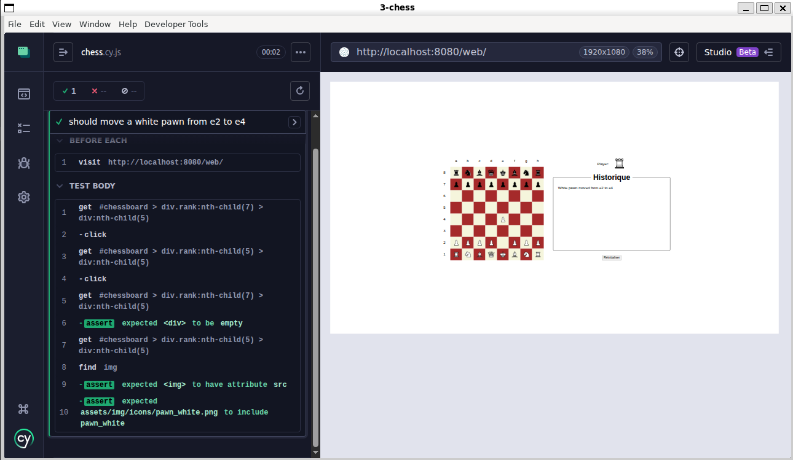

# Lab 3 – Answers

## 1-money

* m1 is created once and shared by all tests, test 1 adds 20 so m1 is 30, then test 2 gives 40 instead of 20.
* `beforeEach`, it runs before every test so each test gets a new m1.
* expect wraps the value in a function and works with any value, should adds `.should` to every object so it doesn't work on null/undefined.

## 3-chess

* lines 53-54 (moving more than 2 ranks or 1 file) and 69-70 (black pawn going up), + the black side of `isInInitialPosition()` (line 26).
* no, it tests two invalid moves not a valid one.
* no, coverage only means the lines ran. a black pawn can still move 1 cell sideways (e.g. d5 → c5), and the queen bug (`super.canMove(this, rank, file)`) was only found by replaying the game.
* 48 tests, 6 per file times 8.

## Coverage report (`npm run report`)

```
76 passing
8 pending
5 failing   (the game.js tests, because of the queen bug)
```

HTML report: `3-chess/coverage/index.html`. Same report in text form:

```
-------------------|---------|----------|---------|---------|-------------------
File               | % Stmts | % Branch | % Funcs | % Lines | Uncovered Line #s
-------------------|---------|----------|---------|---------|-------------------
All files          |   96.62 |    81.81 |   88.88 |   96.62 |
 src               |   97.06 |    84.84 |    87.5 |   97.06 |
  bishop.js        |     100 |       75 |     100 |     100 | 33
  chessboard.js    |     100 |      100 |     100 |     100 |
  color.js         |     100 |      100 |     100 |     100 |
  king.js          |   76.31 |      100 |      50 |   76.31 | 27-35
  knight.js        |   95.55 |    83.33 |     100 |   95.55 | 40-41
  pawn.js          |     100 |      100 |     100 |     100 |
  piece.js         |   98.01 |    78.94 |      75 |   98.01 | 139-140,150-152
  queen.js         |   95.55 |       50 |     100 |   95.55 | 40-41
  rook.js          |   95.45 |       60 |     100 |   95.45 | 39-40
 src/notifications |   93.25 |    54.54 |     100 |   93.25 |
  capture.js       |   93.33 |       50 |     100 |   93.33 | 24-25
  move.js          |   89.74 |       40 |     100 |   89.74 | 24-25,33-34
  notification.js  |     100 |      100 |     100 |     100 |
-------------------|---------|----------|---------|---------|-------------------
```

## Cypress


